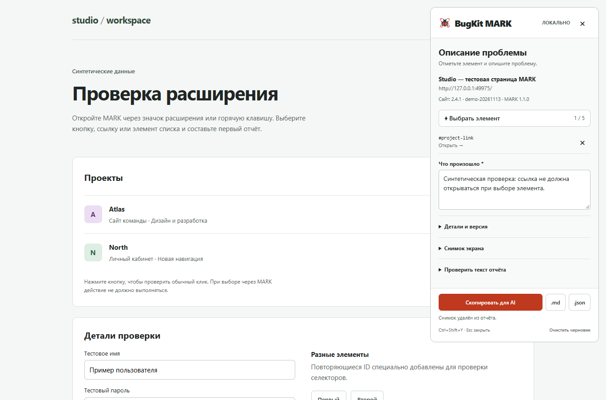

# BugKit

Capture bug reports in Chrome, or add reporting to your application. Reports include a description, page context and selected elements, with Markdown for a developer or coding agent.

[Download Chrome extension](https://github.com/bglglzd/bugkit/releases/latest) · [Installation](INSTALL.md) · [Русская инструкция](docs/INSTALL.ru.md) · [Demo and documentation](https://bglglzd.github.io/bugkit/)



## Chrome extension: BugKit MARK

1. Download **BugKit-MARK-1.1.0.zip** from [Releases](https://github.com/bglglzd/bugkit/releases/latest) and extract it to a permanent folder.
2. Open `chrome://extensions`, enable **Developer mode**, choose **Load unpacked** and select the extracted **extension** folder containing `manifest.json`.
3. Open a website. Click the BugKit MARK toolbar icon, or press **Ctrl+Shift+Y** (**⌘+Shift+Y** on macOS).
4. Select an element, describe the problem and review the report. Copy Markdown or save `.md`, `.json` and an optional screenshot.

No Git, Node.js, account, API key or build is needed. The interface is currently in Russian. Change the shortcut at `chrome://extensions/shortcuts`. Keep the extracted folder: Chrome loads the extension from there. To update, replace its contents, click **Reload** on the extension card and reload the website tab. GitHub ZIP installations do not update automatically. There is no Chrome Web Store listing.

The panel is injected only when invoked. Reports stay local until copied or exported. Session drafts retain text and selected elements across page reloads; screenshots must be added again after a reload. Drafts disappear when the tab or browser session closes. The extension cannot detect logout on arbitrary websites: clear its draft before sharing a browser session or changing accounts.

URL credentials, query parameters and fragments are removed from report context. Form values, full HTML, console history and network traffic are not collected. Selected visible text, URL paths and screenshots can still contain private information; review them before sharing. Screenshots require a separate action, cover the visible viewport and exclude the MARK panel.

Chrome blocks injection on internal pages, its extension store and some viewers. Closed Shadow DOM and iframe contents are not inspected. File URLs require **Allow access to file URLs**. MARK does not send issues to a server or change their status. See [permissions and limitations](docs/EXTENSION.md).

## Add BugKit to an application

This path adds a form, storage, status management and notifications to an existing project. It uses a specification and agent instructions; it is not a prebuilt backend. [INSTALL.md](INSTALL.md) covers both paths.

For Claude Code, run each command separately:

```text
/plugin marketplace add bglglzd/bugkit
/plugin install bugkit@bugkit
/bugkit:install
```

For other agents, pass this instruction:

```text
Install BugKit in this project using https://raw.githubusercontent.com/bglglzd/bugkit/main/INSTALL.md
```

The installer reuses existing UI, authentication and storage, then implements the selected [recipe](recipes/). Both installer paths require [integration acceptance checks](HARDENING.md), including draft recovery, access checks, safe context export and separate technical/user resolution notes. Optional voice input belongs to application integrations; MARK has no microphone feature. Browser speech recognition may use the browser provider's service.

## Develop and verify

Node.js **24 LTS or newer** is needed for development. The regular checks have no dependencies:

```sh
npm run check
npm test
npm run demo
```

The synthetic demo listens on `http://127.0.0.1:4173`. Stop it with Ctrl+C. Browser acceptance uses a pinned development dependency and Chromium:

```sh
npm ci
npx playwright install chromium
npm run test:browser
```

Browser checks use a disposable profile and real extension APIs. They do not operate an existing browser. [Validation boundaries](VALIDATION.md) distinguish automated checks from manual Windows/macOS verification and provider fixtures.

To build the release ZIP, install Python **3.11+** and run `python scripts/package.py` from a clean committed checkout. Its manifest binds the source commit and SHA256 of packaged files; local data, dependencies and private evidence are excluded.

## Reference

- [SPEC.md](SPEC.md): portable v1 report fields and context format, with additive reliability fields.
- [HARDENING.md](HARDENING.md): required behavior for application integrations.
- [recipes/](recipes/): database, GitHub Issues, Telegram, JSONL, email, Slack/Discord and CLI examples.
- [Contributing](CONTRIBUTING.md), [changelog](CHANGELOG.md), [security](SECURITY.md) and [MIT license](LICENSE).

BugKit MARK was contributed as a standalone local extension and integrated here with its name retained. Application-specific code and internal deployment instructions are not part of this repository.
