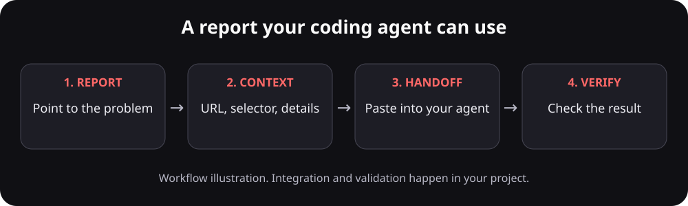

<div align="center">


# bugkit

**Bug reports with context your coding agent can use.**

*Capture the page, selected element and errors with a report. Give the structured context to your coding agent, verify its patch, and record the resolution.*



*Workflow illustration; integration and validation happen in your project.*

<br><br>

[](https://github.com/bglglzd/bugkit)
[](./SPEC.md)
[](./LICENSE)

</div>

---

## Who this is for

**🛠  Building for a client, boss, or team lead**
Send them the staging link. They select the affected element and type or speak a description. Copy the structured report to your agent, then verify and record the fix.

**🚀  Running a product with real users**
Reports can include the URL, selector, stack trace and voice transcript. Choose a recipe for storage/delivery and connect its status and notification flow to your application.

---

## Install

### Claude Code

Three commands. Paste each one separately and wait for it to finish before the next.

**1.** Add the bugkit marketplace:

```
/plugin marketplace add bglglzd/bugkit
```

**2.** Install the plugin:

```
/plugin install bugkit@bugkit
```

**3.** Start the installer in your project:

```
/bugkit:install
```

### Any other AI agent

Cursor, GitHub Copilot, ChatGPT, Gemini, Aider, Cline — paste this one line into the chat:

```
Install bugkit in this project from https://raw.githubusercontent.com/bglglzd/bugkit/main/INSTALL.md
```

---

Either path detects your stack, asks **one** question (where should bug reports go — DB, GitHub Issues, Telegram, JSONL, email, Slack, Discord), and implements the matching [recipe](./recipes/). Voice transcription is offered too — 🎤 mic button next to the description field, Web Speech API by default, local Whisper as an offline upgrade, never paid APIs.

This repository ships a specification, plugin prompts and integration recipes.
The installer adapts them to your project; it is not a hosted reporting service.
Verify the generated integration using that project's actual UI or CLI.

---

## Why this beats a feedback form

| Traditional feedback form | bugkit |
|---|---|
| "Something is broken" | Selector, XPath, HTML, viewport, stack trace, voice transcript |
| Rebuild context in every conversation | Copy one predictable context block |
| Format differs per project | Standardized spec — same ritual across every project |
| No defined status flow | Status lifecycle and notification recipes |
| Typing long descriptions is a chore | 🎤 press-to-speak, auto-transcribed |

---

## Docs

- **[SPEC.md](./SPEC.md)** — the portable data contract
- **[recipes/](./recipes/)** — 7 sink adapters (DB, GitHub Issues, Telegram, JSONL, email, Slack, Discord, CLI)
- **[INSTALL.md](./INSTALL.md)** — the universal paste-in prompt for non-Claude-Code agents
- **[Landing page](https://bglglzd.github.io/bugkit)** — one-page tour with copy-ready install commands

## Verify the recipes

With Node.js 24 LTS, no package installation is required:

```bash
node --test tests/*.test.mjs
```

The checks execute documented snippets with real temporary JSONL files and
loopback HTTP services. Browser speech, provider SDKs and report stores used by
adapter tests are explicit synthetic fixtures. Tests do not contact Telegram,
Slack, Discord, email, GitHub Issues or a paid AI service. See
[validation boundaries](./VALIDATION.md) and [contributing](./CONTRIBUTING.md).

---

MIT — use it anywhere. ⭐ Star or watch this repo for new releases.
